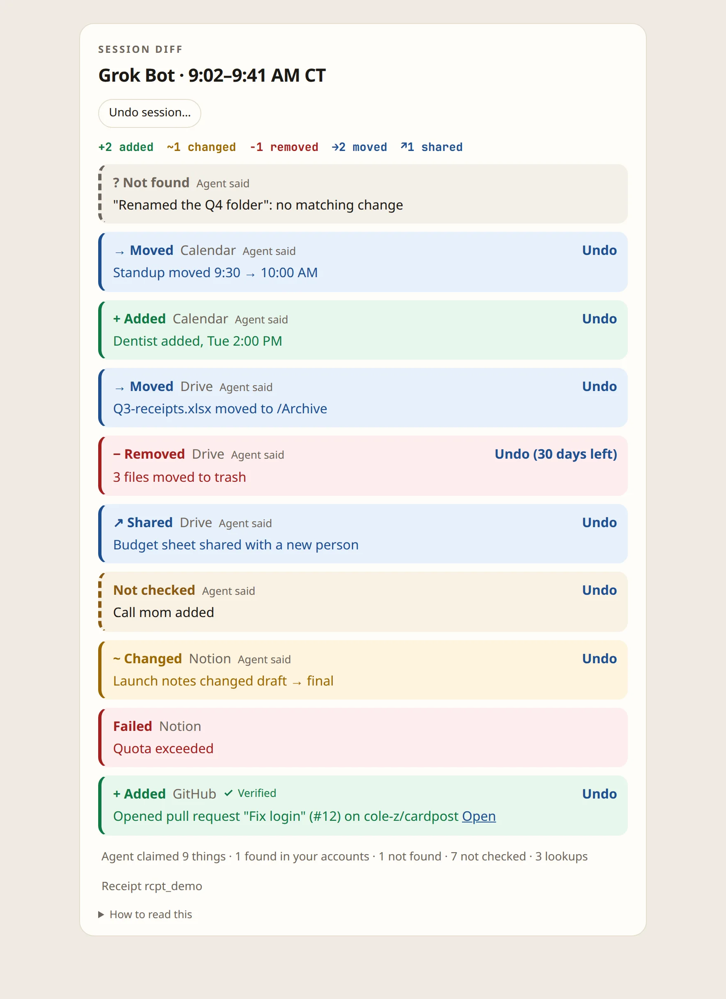
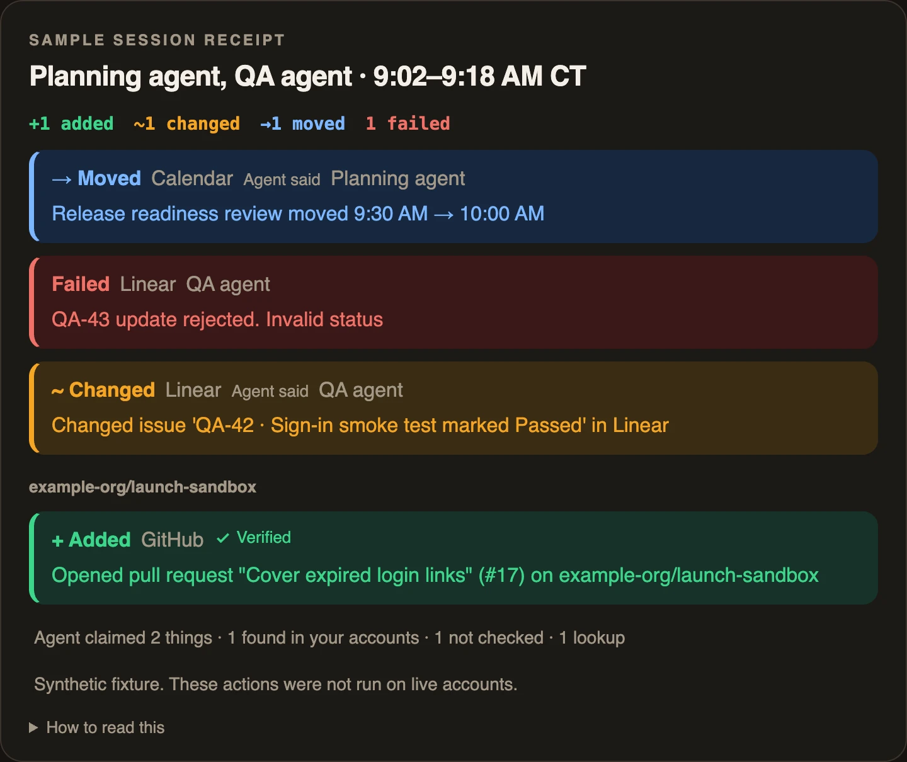
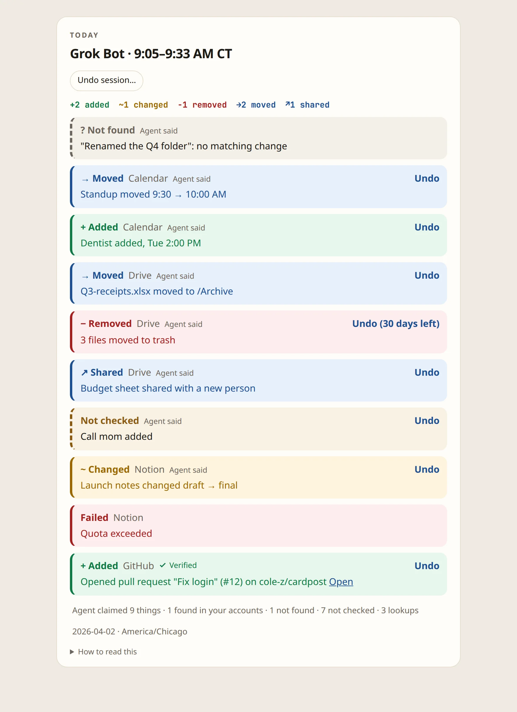
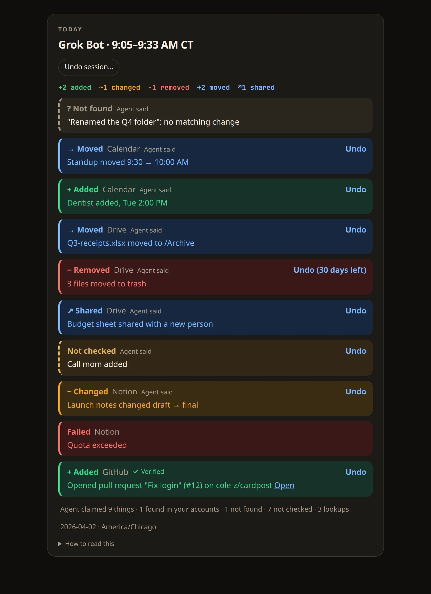

# Life Diff

Get a receipt for what your AI agents changed.

Life Diff is a hosted MCP proxy with session receipts and a daily roundup. Receipts cover tool calls routed through Life Diff, changes an agent explicitly reports, and optional checks on GitHub repositories you name. [Open the interactive sample receipt.](https://lifediff.dev/sample-receipt)

## Hosted quickstart

1. Add `https://lifediff.dev/mcp` as a remote Streamable HTTP server. Copy your client's recipe from the [connection guide](docs/connect.md).
2. Follow your client's OAuth prompt and sign in with GitHub. Use `list_receipts` or `list_upstreams` to confirm Life Diff's tools are available. [Repository checks have a separate opt-in.](docs/github-checks.md)
3. [Run the public DeepWiki lookup](docs/connect.md#first-lookup). Refresh the tool catalog after registering DeepWiki, use Life Diff's namespaced lookup, and close the session. On a clean session you should see **Nothing changed · 1 lookup**. The receipt is saved and `get_receipt` can render its card.

If OAuth stalls or an upstream's tools are missing, use the [client guide's troubleshooting steps](docs/connect.md#troubleshooting). The guide records which client paths have been tested.

## Read a receipt

| Label | Meaning |
| --- | --- |
| **Verified** | Life Diff independently corroborated a supported change. |
| **Agent said** | The agent reported a change, or Life Diff forwarded the call without independently confirming the resulting state. |
| **Not found** | A check ran and found no matching change. |
| **Not checked** | An independent check was unavailable. |
| **Failed** | The tool reported an error or the relay failed. |
| **Sent to [service]** | Life Diff routed the lookup to that service. |

The sample uses synthetic data throughout.

- **Developer** sees PR #17, “Cover expired login links”, added in the named test repository `example-org/launch-sandbox`. The **Verified** label represents independent GitHub corroboration.
- **QA engineer** sees a routed Linear update marking QA-42 **Passed**, next to a **Failed** update to QA-43. The successful tool result has the **Agent said** label.
- **Project manager** sees the release readiness review moved from **9:30 AM** to **10:00 AM**, with the planning agent as the source.
- **Heavy AI user** can review the whole local calendar day with `get_daily_diff` or [Today](https://lifediff.dev/roundup), including lookups and activity across sessions.

More fixture views

## Hosted beta details

Clients on the same GitHub account share one open session. Rows show recorded client names where available. Close with `end_session` for an immediate receipt. The default 20-minute idle preference makes a session eligible to close on the next session-opening activity or hourly sweep. [Session boundaries, tool results, refresh, and undo.](docs/connect.md#beta-behavior)

Hosted forwarding uses operator-approved endpoints and relays text and object-valued structured results. The public demo approves DeepWiki at `https://mcp.deepwiki.com/mcp`. Receipts store bounded arguments and excerpts that can contain ordinary document or message text. Redaction covers recognized secret patterns and can miss sensitive content. Signed receipt and roundup links are access credentials. Use [Settings](https://lifediff.dev/settings) to clear history or [Account](https://lifediff.dev/account) to delete your Life Diff account. Both controls require browser sign-in and confirmation. [Hosted data and privacy.](PRIVACY.md)

Tool reference and self-hosting

[Hosted tools, architecture, and self-hosting](hosted/README.md) · [Repository check setup](docs/github-checks.md) · [Registry metadata](docs/marketplace.md) · [Contributor guide for providers](docs/providers.md)

## Run locally

Build from source with **Go 1.26.11 or newer**. There are currently no tagged releases or downloadable binaries. [Local build and stdio proxy setup](docs/local-proxy.md) · [Local Google snapshot setup and data handling](docs/local-google.md)

[Apache License 2.0](LICENSE).
