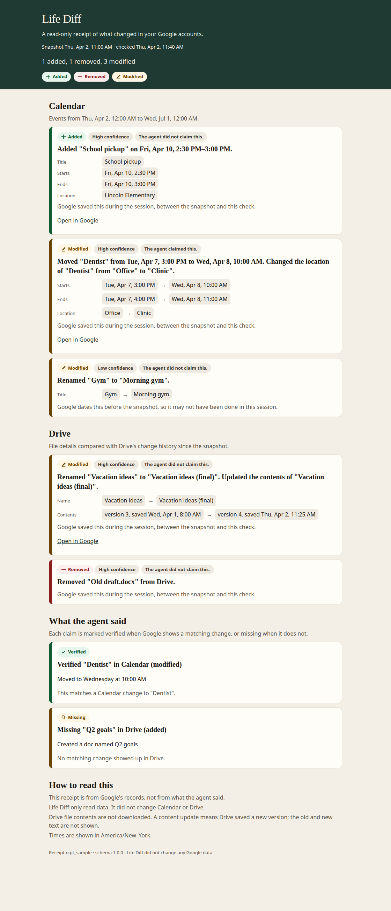

# Life Diff

Life Diff shows what an AI agent changed in your Google accounts. It reads Calendar and Drive itself, compares that with a snapshot taken before the agent ran, and writes a receipt. The receipt is the record. The agent's "done" is only a claim.

This version is read-only, self-hosted, and covers one session of **Google Calendar** and **Google Drive**. It does not download file bodies, and it does not create, edit, or delete anything in Google.



The picture above is the sample report rendered from fixture data, not from a live account. The same page is checked in as [docs/sample-report.html](docs/sample-report.html).

## What you get

- **Added** in green, **Removed** in red, **Modified** in amber, each with an icon and a label.
- A plain-language sentence, such as `Moved "Dentist" from Tue, Apr 7, 3:00 PM to Wed, Apr 8, 10:00 AM.`
- Field-level before and after values.
- Optional claim checking: each claim is **verified** or **missing**, and each real change the agent did not mention is **not claimed**.
- A confidence level from the session window. High means Google dates the change between the snapshot and the check. Low means Google dates it earlier, so it may be an older edit.

Calendar and Drive do not keep the history this needs, so Life Diff stores the snapshot on your computer. A Calendar sync token and the Drive Changes API are used when Google provides them. If a token expires, Life Diff reads the calendar window or the file list again and says so on the receipt.

## Install

```bash
git clone https://github.com/Cole-Z/life-diff.git
cd life-diff
go build -o lifediff ./cmd/lifediff
```

Go 1.26 or newer. The core is the importable package `github.com/Cole-Z/life-diff` (Go package name `lifediff`). A hosted product can call `Engine` with its own `CalendarReader` and `DriveReader`.

## Create a Google OAuth client

You use your own desktop OAuth client. For personal use, with the app in **Testing** and your account listed as a test user, Google does not require app verification.

1. Open [Google Cloud Console](https://console.cloud.google.com/) and create a project, for example `Life Diff`.
2. **APIs & Services → Library**. Enable **Google Calendar API** and **Google Drive API**.
3. **APIs & Services → OAuth consent screen**.
   - User type: **External** (or Internal, if this is a Workspace org you administer).
   - App name: `Life Diff`.
   - Add your Google account under **Test users**.
   - Add the scopes below. Life Diff requests only these:
     - `https://www.googleapis.com/auth/calendar.readonly`
     - `https://www.googleapis.com/auth/drive.metadata.readonly`
   - Leave the publishing status as **Testing**.
4. **APIs & Services → Credentials → Create credentials → OAuth client ID**.
   - Application type: **Desktop app**.
   - Download the JSON.
5. Save it as `~/.lifediff/credentials.json` and restrict it to your user:

   ```bash
   mkdir -p ~/.lifediff
   chmod 700 ~/.lifediff
   install -m 600 ~/Downloads/client_secret_*.json ~/.lifediff/credentials.json
   ```

   Or set `LIFEDIFF_CREDENTIALS` to the file path. Do not commit this file. The repo ignores `credentials.json` and `token.json`.

`drive.metadata.readonly` can see names, folders, trash state, size, checksum, and version. It cannot see the words inside a Doc. A content edit shows up as a new version.

While the app stays in Testing, Google expires refresh tokens after seven days. Run `lifediff auth` again when a command says the sign-in needs to be refreshed.

## Sign in

```bash
./lifediff auth
```

Life Diff listens on `127.0.0.1` and prints a link. Open it, choose the test user, and allow read-only access. The token is saved at `~/.lifediff/token.json` with mode `0600`. The command prints the path, not the token.

```bash
./lifediff auth --status
```

If Google reports `redirect_uri_mismatch`, the desktop client needs the loopback address. `lifediff auth` prints the exact redirect URL it is using (`http://127.0.0.1:<port>/callback`). Add that host as an authorized redirect URI on the OAuth client, or create the client again as a **Desktop app**, which accepts the loopback redirect.

## Check one agent session

```bash
./lifediff snapshot
# let the agent do its work
./lifediff diff --claims claims.json
```

`snapshot` stores Calendar events from 24 hours ago through 90 days ahead, plus Drive file metadata (`trashed = false`, up to 2000 files, newest changes first). Narrow it with `--from`, `--to`, `--calendar`, `--tz`, `--only calendar`, `--drive-query`, and `--max-files`.

`diff` writes:

- `~/.lifediff/receipts/<id>.json` — the receipt ([schema](docs/receipt-schema.md))
- `~/.lifediff/receipts/<id>.html` — the report

Both are mode `0600`. `--json` and `--html` copy them somewhere else, also mode `0600`.

`--strict` exits with status 3 when a claim is missing, a change was not claimed, or you passed no claims and anything changed.

```bash
./lifediff receipt          # print the latest receipt again
./lifediff demo --html docs/sample-report.html --json docs/sample-receipt.json
```

### Claims file

```json
{
  "claims": [
    {"service": "calendar", "action": "modified", "target": "Dentist", "detail": "Moved to Wednesday at 10:00 AM"},
    {"service": "drive", "action": "created", "target": "Q2 goals"}
  ]
}
```

A bare array is also accepted. `action` may be `added`, `removed`, `modified`, or everyday synonyms such as `moved`, `renamed`, `created`, and `deleted`. Omit `--claims` and Life Diff only lists the changes; it does not mark them unclaimed.

## MCP server

`lifediff mcp` speaks MCP over stdin and stdout, using the official Go SDK (`github.com/modelcontextprotocol/go-sdk`). Run `lifediff auth` once first. The tools are `snapshot`, `diff`, and `get_receipt`. Logs stay off stdout so they do not break the protocol.

```json
{
  "mcpServers": {
    "lifediff": {
      "command": "/absolute/path/to/lifediff",
      "args": ["mcp"]
    }
  }
}
```

An agent skill that tells the agent when to snapshot and how to read the receipt is in [skills/life-diff/SKILL.md](skills/life-diff/SKILL.md).

## Where data lives

| Path | What it is |
| --- | --- |
| `~/.lifediff/credentials.json` | Your OAuth client file. You create it. |
| `~/.lifediff/token.json` | Saved sign-in. Mode `0600`. |
| `~/.lifediff/snapshots/` | Before-images, including event titles and file names. Mode `0600`. |
| `~/.lifediff/receipts/` | JSON receipts and HTML reports. Mode `0600`. |

Override the directory with `LIFEDIFF_HOME`. Life Diff creates it as mode `0700`. Nothing is sent anywhere except to Google's own APIs, and those calls are GET requests with the two read-only scopes.

## Library

`Engine.TakeSnapshot` and `Engine.Compare` depend on the `CalendarReader` and `DriveReader` interfaces, not on the desktop OAuth flow. `BuildReceipt` is pure: it turns a snapshot and a later read into a receipt. The CLI, the local token store, and the MCP server are wrappers around that.

## Development

```bash
go vet ./...
go test ./...
```

Tests use fake Calendar and Drive JSON under `googleprov/testdata`. They do not call Google. GitHub Actions runs `go vet` and `go test` on push and pull request.

To regenerate the checked-in sample report:

```bash
go run ./cmd/lifediff demo --html docs/sample-report.html --json docs/sample-receipt.json
```

## License

[Apache License 2.0](LICENSE).
